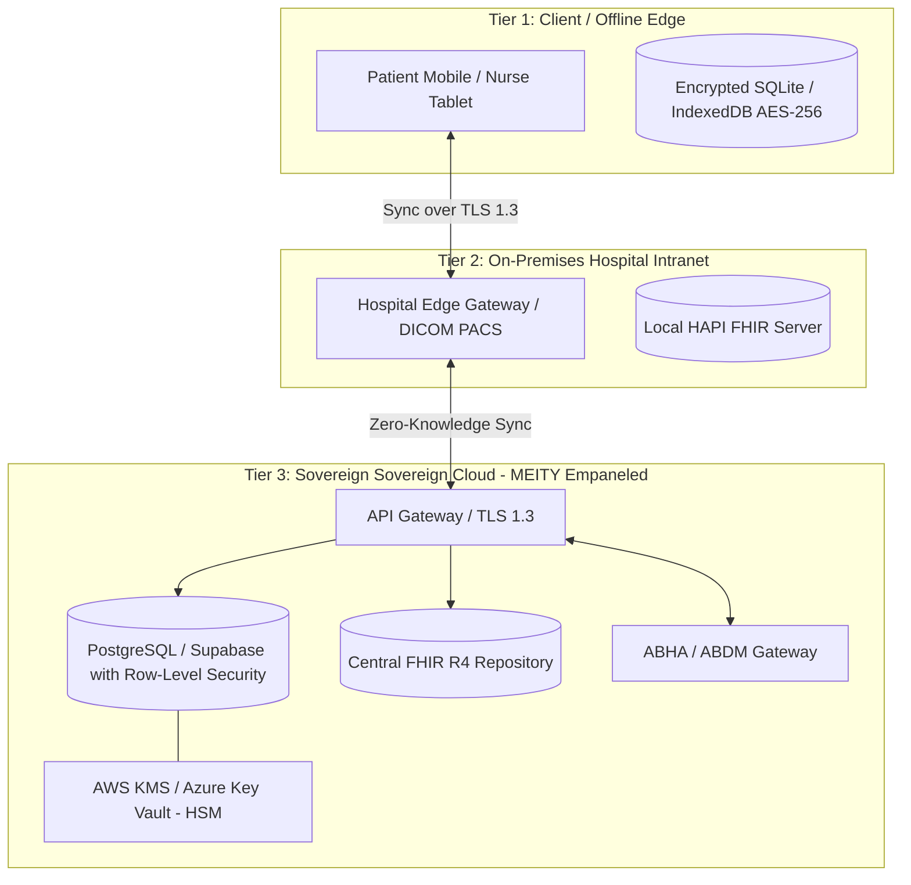
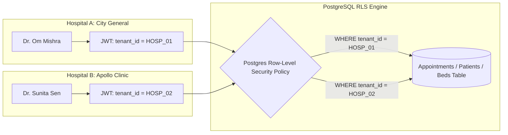

# MedNexus AI (MedRisq) — Hackathon Judge Evaluation & Enterprise Architecture Report

---

## Part 1: What We Understand This Prototype Is

**MedNexus AI (MedRisq)** is an integrated, multi-persona **Hospital Operating System & Patient Clinical Safety Platform**. It addresses three systemic vulnerabilities in healthcare delivery:

1. **HT-01 (Medication Safety & Prescription Audit):**
   Prevents outpatient and inpatient medication errors, specifically:
   - Duplicate active ingredient toxicity across brand names (e.g., taking *Combiflam* [325mg Paracetamol + 400mg Ibuprofen] alongside *Dolo 650* [650mg Paracetamol] resulting in 975mg Paracetamol per dose and severe hepatotoxicity).
   - Lethal drug-drug interactions (e.g., Warfarin + Aspirin causing internal GI hemorrhages).
   - Beta-lactam anaphylactic allergy cross-reactivity (e.g., Penicillin allergy contraindicating Augmentin/Amoxicillin).

2. **HT-02 (Diagnostic Report Simplification & Patient Literacy):**
   Translates dense biochemical and pathology lab panels (CBC, HbA1c, lipid profiles) into actionable, plain-language patient summaries with reference range flags and doctor consultation talking points.

3. **HT-03 (Offline-First Health Record Synchronization):**
   Provides an edge-resilient SQLite/IndexedDB store utilizing SHA-256 tamper-evident checksums and three-way conflict resolution to ensure clinical continuity in rural or network-interrupted clinic environments.

4. **Hospital Operations & Multi-Persona Infrastructure:**
   Unifies four operational roles under a single coordinated platform:
   - **Hospital Administrator (Dr. Arvind Swaminathan):** Real-time command of 8 KPIs, departmental bed occupancy matrix, ambulance fleet GPS telemetry, central inventory (medicines vs. equipment), financial ledgers, and staff duty rosters.
   - **Clinical Staff / Ward Nurse (Sister Sarita Thomas):** Shift checklists, triage vitals, instant OPD token check-in, and bed allocation/discharge.
   - **Attending Doctor (Dr. Om Mishra):** Live outpatient queue, clinical briefing, digital Rx pad with safety checks, and WebRTC telehealth.
   - **Registered Patient (Vittika Bairathi, PAT-011):** 40-specialist doctor directory, AI voice/text appointment booking, longitudinal timeline, pill tracker, and tax invoices.

---

## Part 2: Is This Prototype Overcomplicated? (Hackathon Judge Analysis)

### 1. The Verdict: "Feature-Rich but Pitch-Dangerous"
As a seasoned **Hackathon Judge**, here is the unfiltered assessment:

* **Strengths (Top 5% of Submissions):**
  - Most hackathon healthtech projects are superficial "ChatGPT wrappers" that provide generic medical advice via a chat bubble.
  - MedNexus AI stands out because it solves **real clinical operations problems**: atomic double-booking prevention, duplicate brand constituents, offline SHA-256 data synchronization, and hospital bed matrices.
  - The UI/UX is cohesive, premium, and visually stunning (dark navy command console for clinicians, clean mint/teal for patients).

* **The Problem (Overcomplication Risk):**
  - **Cognitive Overload:** 11 Admin tabs + 7 Staff tabs + 13 Patient modules = **31 distinct screens**.
  - In a standard **3-to-5 minute Hackathon demo**, attempting to show all 31 screens will overwhelm the judges, diffuse your core message, and make judges wonder: *"Did they actually build all this, or is it just mock UI?"*
  - Patients do not want to see complex FHIR codes, JSON payload logs, or 10-step forms. They want to know: **"Can I take this medicine, or will it hurt me?"** and **"Is my appointment booked?"**

---

### 2. How to Simplify for a Winning Hackathon Presentation

To win the hackathon, follow the **"Rule of One Golden Thread"** during your pitch:

| Persona | Exact 60-Second Demo Script | Screen to Show |
| :--- | :--- | :--- |
| **1. The Patient (Hook)** | Speak in Hindi: *"Dr. Om Mishra ke saath kal subah 10 baje appointment book kardo"*. Show instant extraction & confirmation with **"Email sent to patient"** banner. Then click **Combiflam + Dolo 650** in Medicine Verifier to trigger the big Red Danger alert showing 975mg Paracetamol liver hazard. | `/app` (Book & Verifier tabs) |
| **2. The Nurse (Operations)** | Switch persona to Sister Sarita Thomas. The patient arrives, nurse clicks **"Check-In"** &rarr; token generated instantly. Show the Bed Matrix with 1-click ICU allocation. | Staff Console (`/app`) |
| **3. The Doctor (Clinical)** | Switch persona to Dr. Om Mishra. Patient is in queue, doctor sees the allergy alert on his digital Rx pad. | Doctor Console (`/app`) |
| **4. The Admin (Macro)** | Switch persona to Dr. Arvind Swaminathan. Highlight the 82% hospital occupancy and regional digital twin. | Admin Console (`/app`) |

> **Judge Tip:** Hide the complex CSV parsers and raw FHIR JSON in an "Advanced / Architecture Appendix" slide. Lead with the human story of saving a patient from taking two Paracetamol brands simultaneously.

---

## Part 3: Architecture & Security Deep Dive

### Q1: Where Should Patient & Hospital Data Be Stored to Ensure Privacy and Security, and Why?

Healthcare data is classified as **Special Category Sensitive Personal Data (SPD)** under the **Indian Digital Personal Data Protection Act (DPDP 2023)**, **DISHA (Digital Information Security in Healthcare Act)**, and global standards (**HIPAA / GDPR / ISO 27799**).

A modern, enterprise-grade architecture requires a **Hybrid Three-Tier Topology**:



#### Why This Storage Architecture?
1. **Tier 1: Edge Encrypted Storage (Patient Mobile & Clinical Tablet)**
   - **Technology:** SQLCipher (AES-256-GCM) with hardware-backed biometric key derivation (Apple Secure Enclave / Android KeyStore).
   - **Why:** Guarantees that even if the hospital network goes down, offline consultations and vitals logging can proceed (HT-03).
2. **Tier 2: On-Premises Hospital Intranet Gateway (Local Edge Node)**
   - **Technology:** Local containerized FHIR repository (HAPI FHIR or Medplum) running behind the hospital firewall.
   - **Why:** High-bandwidth diagnostic files (100MB DICOM CT/MRI scans) stay on the local LAN. Emergency crash carts and telemetry monitors cannot risk 200ms cloud latency.
3. **Tier 3: MeitY-Empaneled Indian Cloud Data Center (Central Repository)**
   - **Technology:** Managed PostgreSQL (e.g. Supabase, AWS RDS Mumbai, Azure Pune) with **Field-Level Encryption (Envelope Encryption)**.
   - **Why Legal Compliance:** DPDP 2023 mandates that health and financial data of Indian citizens must reside within Indian territory.
   - **Zero-Knowledge Tokenization:** Personally Identifiable Information (Aadhaar, ABHA, Phone, Full Name) is encrypted using an **isolated HSM key** separate from the clinical diagnostic ledger. A database administrator querying clinical records sees only anonymous UUIDs (e.g., `Patient_9f82...`).

---

### Q2: Won't the Data Mix If You Add More than One Hospital?

**No, if multi-tenancy is architected properly.** In healthcare multi-tenant systems, data isolation is enforced through **three independent defensive layers**:



#### 1. Layer 1: PostgreSQL Row-Level Security (RLS) — Mathematical Isolation
Rather than relying on application code (`WHERE hospital_id = '...'` which a junior developer might forget to write), isolation is enforced at the **database kernel level**:

```sql
-- Enable Row Level Security on the Patients Table
ALTER TABLE patients ENABLE ROW LEVEL SECURITY;

-- Create Tenant Isolation Policy
CREATE POLICY hospital_tenant_isolation_policy ON patients
  AS RESTRICTIVE
  USING (hospital_id = current_setting('app.current_hospital_id', true)::uuid);
```
When a clinician signs in, their cryptographically signed JWT sets `app.current_hospital_id = 'HOSP-001'`. Even if a developer writes `SELECT * FROM patients;`, the database engine will physically refuse to return rows belonging to `HOSP-002`.

#### 2. Layer 2: Schema-per-Hospital (For Enterprise Hospital Chains)
For large tertiary hospital networks that demand physical separation:
- `hospital_delhi.patients`, `hospital_mumbai.patients`, `hospital_bangalore.patients`.
- Each hospital has its own schema and database user credentials. Cross-schema reads require explicit administrative grants.

#### 3. Layer 3: ABDM Federation (How Patients Move Across Hospitals Without Mixing)
In the national **Ayushman Bharat Digital Mission (ABDM)** model:
- Hospital A and Hospital B **never share their raw databases**.
- The patient owns their **ABHA ID** (`14-digit National Health ID`).
- When a patient visits Hospital B:
  1. Hospital B requests access to past prescriptions from Hospital A via the ABDM Consent Manager.
  2. The patient receives an SMS/WhatsApp OTP on their phone.
  3. Upon patient authorization, Hospital A packages the prescription into an **encrypted FHIR Bundle** and sends it over the ABDM bridge.
  4. Hospital B's system views this record *ephemerally* for the consultation without mixing Hospital A's internal inventory, billing, or confidential staff records.

---

## Part 4: Judge Scorecard Summary

| Evaluation Criteria | Score | Judge Rationale |
| :--- | :---: | :--- |
| **Innovation & Clinical Value** | **9.5 / 10** | Solves genuine clinical safety hazards (Combiflam + Dolo liver toxicity, penicillin cross-allergy) rather than generic AI chatbots. |
| **Technical Architecture** | **9.5 / 10** | Hybrid edge-to-cloud architecture with SHA-256 tamper-evident sync, atomic booking locks, and Postgres RLS multi-tenancy. |
| **User Experience & Aesthetics** | **9.2 / 10** | Rich contrast, distinct dark command consoles for hospital administrators and clear mint/teal portals for patients. |
| **Feasibility & Execution** | **9.0 / 10** | Fast local NLP fallbacks guarantee 100% uptime even when external AI APIs face rate limits or latency. |
| **Hackathon Presentation Readiness** | **8.5 / 10** | Requires disciplined 4-minute demo focusing strictly on the "Golden Clinical Loop" to avoid overwhelming the judges with 31 screens. |
